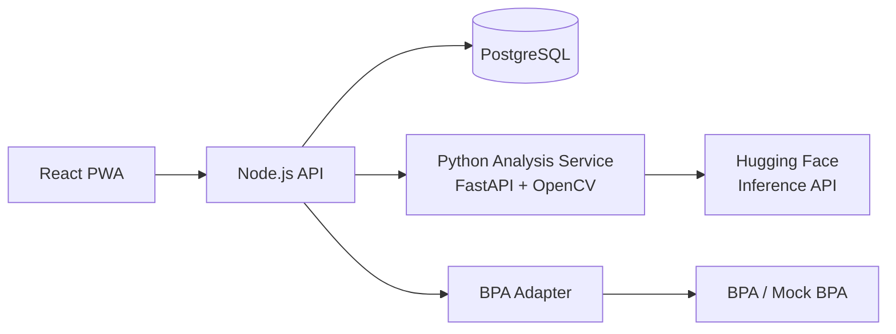

# 🐄 Auto-ATC: AI-Based Animal Type Classification for Cattle and Buffaloes

> A smartphone-first system that measures a cattle or buffalo's body structure from photos, assigns standardized Animal Type Classification (ATC) scores, and saves the result as a structured record ready to sync with the Bharat Pashudhan App (BPA).


---

## 📌 Table of Contents

1. [Problem Statement](#-problem-statement)
2. [Our Approach](#-our-approach)
3. [Key Features](#-key-features)
4. [Architecture](#-architecture)
5. [Image Capture Protocol](#-image-capture-protocol)
6. [Traits and Scoring](#-traits-and-scoring)
7. [Tech Stack](#-tech-stack)
8. [Project Structure](#-project-structure)
9. [Getting Started](#-getting-started)
10. [API Overview](#-api-overview)
11. [BPA Integration](#-bpa-integration)
12. [Success Metrics](#-success-metrics)
13. [Limitations](#-limitations)
14. [Roadmap](#-roadmap)
15. [Team](#-team)

---

## 🎯 Problem Statement

**Image Based Animal Type Classification for Cattle and Buffaloes**

Under the Rashtriya Gokul Mission (RGM), a trained Animal Typer inspects each animal, judges and measures body parts by eye and by hand, and enters scores in BPA. Even trained people make inconsistent calls because of fatigue, bias, and measurement error. This weakens the data used in Progeny Testing (PT) and Pedigree Selection (PS).

**Goal:** replace visual estimation and manual measurement with image-based measurement and rule-driven scoring, so the same animal gets the same score no matter who takes the photo.

---

## 💡 Our Approach

We deliberately **do not train any models**. Instead we combine:

1. **Pretrained models via the Hugging Face Inference API** for animal detection and segmentation.
2. **Classical computer vision (OpenCV)** for image quality checks and ArUco marker detection (real-world scale).
3. **Geometry on the segmentation mask** to locate body landmarks (withers, hooves, rump, etc.).
4. **Human-in-the-loop adjustment**: the typer can drag landmarks to correct them before scoring.
5. **Config-driven rule-based scoring** (1 to 9 scale), deterministic and explainable.

```
Photo + reference marker → quality check → HF segmentation → landmarks
→ pixel-to-cm → measurements → 1-9 trait scores → saved record → BPA
```

---

## ✨ Key Features

- 📷 Camera capture with on-screen guidance (outline, distance, level indicator)
- 🧪 Instant quality feedback (blur, lighting, cropping, wrong angle)
- 📏 Measurements in cm and degrees with a confidence value
- ✋ Landmark adjustment and score override, with the AI value and final value both stored
- 🔢 Rule-based 1 to 9 trait scores plus an overall score, with breed-aware thresholds in config files
- 🗂 Records with images, measurements, scores, quality flags, and pipeline version
- 📤 CSV and JSON export
- 🔌 BPA adapter (tested against a mock BPA endpoint) with retry and sync status
- 📱 Installable PWA for Android Chrome and iOS Safari

---

## 🏗 Architecture



| Component | Folder | Responsibility |
|---|---|---|
| Frontend | `app/` | Camera capture, guidance overlay, landmark adjust, results, records, export |
| Backend | `api/` | Auth, evaluations, image storage, calls analysis service, BPA adapter, exports |
| Analysis service | `src/` | Quality checks, HF API calls, marker detection, landmarks, measurement, scoring |
| Config | `configs/` | Scoring thresholds per species and breed (YAML) |

> The architecture (Node backend plus Python service vs. a single Python backend) is still to be confirmed by the team.

---

## 📸 Image Capture Protocol

A single photo has no real-world scale, so a fixed protocol and a reference marker are what make centimetre values trustworthy.

- Animal standing squarely on level ground, head natural and up, all four legs visible
- True side view, camera at roughly mid-body height and perpendicular to the animal, about 4 to 5 m away (to be tuned)
- Whole animal in frame including all four hooves; no people, ropes, or other animals overlapping
- A reference object of known size in the **same plane as the animal's body** (printed ArUco marker on a stand, or a 1 m rod with marked ends)
- Even daylight; avoid strong backlight and harsh shadows
- Rear view (stretch): animal centered, tail aside, both pin bones and hooves visible

---

## 🧬 Traits and Scoring

Scoring is **rule-based**: each measurement maps to a 1 to 9 score through thresholds in `configs/`, set per species and breed from ATC guidelines and expert input.

| Trait | View | How it is measured | Priority |
|---|---|---|---|
| Stature (height at withers) | Side | Withers to ground, scaled by marker | MVP |
| Body length | Side | Shoulder point to pin bone | MVP |
| Body depth | Side | Withers to brisket | MVP |
| Rump angle | Side | Slope of hip to pin bone line | MVP |
| Rump width | Rear | Distance between hip points | Stretch |
| Rear legs (side view) | Side | Hock angle | Stretch |
| Chest width | Front | Width at chest floor | Stretch |
| Udder traits | Rear/side | Depth, attachment, teat placement | Stretch |

> The exact trait list and scale must follow the BPA ATC form and ICAR/NDDB guidelines (to be confirmed).

---

## 🛠 Tech Stack

| Layer | Technologies |
|---|---|
| Frontend | React (Vite), PWA |
| Backend | Node.js, Express |
| Analysis service | Python 3.10+, FastAPI, OpenCV (incl. ArUco), NumPy, Pydantic |
| Pretrained models | Hugging Face Inference API (detection / segmentation) |
| Database | PostgreSQL |
| Config | YAML |
| Deployment | Docker, docker-compose |

---

## 📁 Project Structure

```
auto-atc/
├── app/                  # React PWA
├── api/                  # Node.js backend
├── src/                  # Python analysis service
│   ├── quality/          # Blur, brightness, framing checks
│   ├── hf_client.py      # Hugging Face Inference API wrapper
│   ├── marker.py         # ArUco detection, pixel-to-cm
│   ├── landmarks.py      # Landmarks from mask geometry
│   ├── measurement.py    # Height, length, depth, rump angle
│   ├── scoring.py        # Config-driven 1-9 scoring
│   └── main.py           # FastAPI: /predict, /health
├── configs/              # Scoring thresholds (YAML)
├── data/                 # Small validation set + notes
├── notebooks/            # Experiments
├── tests/
├── docker-compose.yml
├── requirements.txt
└── README.md
```

---

## 🚀 Getting Started

### Prerequisites

- Python 3.10+, Node.js 18+, Docker
- A free [Hugging Face account](https://huggingface.co/join) and access token

### Setup

```bash
git clone https://github.com/<your-username>/auto-atc.git
cd auto-atc

# Environment variables (never commit this file)
cp .env.example .env
# then set HF_TOKEN=<your token> in .env

# Database
docker-compose up -d

# Analysis service
python -m venv venv && source venv/bin/activate
pip install -r requirements.txt
uvicorn src.main:app --reload --port 8000

# Backend
cd api && npm install && npm run dev

# Frontend
cd app && npm install && npm run dev
```

---

## 🔌 API Overview

**Backend (Node.js)**

| Method | Endpoint | Purpose |
|---|---|---|
| POST | `/api/auth/login` | Login |
| POST / GET | `/api/animals` | Register / look up by tag |
| POST | `/api/evaluations` | Upload images, run analysis |
| GET | `/api/evaluations`, `/api/evaluations/:id` | List / view |
| PATCH | `/api/evaluations/:id/scores` | Override a score |
| POST | `/api/evaluations/:id/sync-bpa` | Sync to BPA |
| GET | `/api/evaluations/export?format=csv\|json` | Export |

**Analysis service (FastAPI)**

| Method | Endpoint | Purpose |
|---|---|---|
| POST | `/predict` | Images + metadata in; quality flags, landmarks, measurements, scores out |
| GET | `/health` | Health check |

**Example `/predict` response**

```json
{
  "species": "buffalo",
  "quality_flags": [],
  "landmarks": { "withers": [412, 188], "pin_bone": [910, 240] },
  "measurements": [
    { "name": "height_at_withers", "value": 138.2, "unit": "cm", "confidence": 0.82 },
    { "name": "rump_angle", "value": 21.5, "unit": "deg", "confidence": 0.74 }
  ],
  "trait_scores": { "stature": 7, "body_length": 6, "rump_angle": 5 },
  "overall_score": 6,
  "pipeline_version": "0.1.0"
}
```

---

## 🔗 BPA Integration

We do not yet have BPA API documentation or sandbox access.

1. Define our internal record format
2. Write an adapter interface and field-mapping table to the BPA ATC record
3. Build a mock BPA service to demo the full flow
4. Switch to the real endpoint when access is granted

**Fallback:** export a BPA-compatible CSV or JSON for manual upload. Syncing is idempotent, retried on failure, and its status is visible in the app.

---

## 📈 Success Metrics (proposed)

| Metric | Target |
|---|---|
| Height at withers vs. tape measurement | Within 3 cm |
| Agreement with expert scores | QWK ≥ 0.6; within 1 point on ≥ 80% of traits |
| Evaluation time per animal | ≤ 3 minutes |
| Captures passing quality check within 2 attempts | ≥ 90% |
| End-to-end latency | ≤ 10 seconds |
| Lost records in sync tests | Zero |

---

## ⚠️ Limitations

- Accuracy depends heavily on following the capture protocol (pose, angle, marker placement)
- Hosted Hugging Face models can have rate limits and cold-start delays, so latency may vary
- Landmarks derived from geometry are approximate; the adjust step exists for this reason
- Rule thresholds need calibration against expert scores before real-world use
- Real BPA integration depends on access being granted

---

## 🗺 Roadmap

- [ ] **Phase 0:** project setup, docker-compose, base configs
- [ ] **Phase 1:** walking skeleton end to end with dummy output
- [ ] **Phase 2:** capture screen, quality checks, small validation set
- [ ] **Phase 3:** HF segmentation, marker scale, landmarks, measurements, scoring engine
- [ ] **Phase 4:** auth, records, override, export, BPA adapter and mock
- [ ] **Phase 5:** usability testing, offline queue, Dockerized deployment, final docs

---

## 👥 Team

| Name | Role |
|---|---|
| _Member A_ | Frontend and UX (`app/`) |
| _Member B_ | Analysis service and data (`src/`, `data/`) |
| _Member C_ | Backend, database, BPA adapter (`api/`) |

---

## 🤝 Contributing

Branches: `feat/`, `fix/`, `chore/`, `docs/`. Commits follow Conventional Commits. Every PR needs a description and how to test it; `main` must always run.

## 📄 License

MIT
