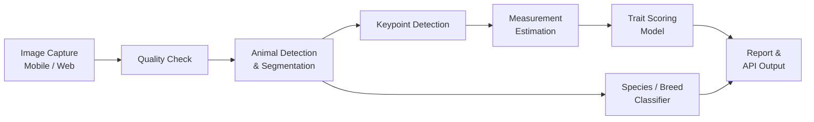

# 🐄 Image-Based Animal Type Classification for Cattle and Buffaloes

> An AI-powered system that evaluates the physical (conformation) traits of cattle and buffaloes from photographs, replacing slow, subjective manual scoring with fast, consistent, and objective results.


---

## 📌 Table of Contents

1. [Problem Statement](#-problem-statement)
2. [Background](#-background)
3. [Our Solution](#-our-solution)
4. [Key Features](#-key-features)
5. [System Architecture](#-system-architecture)
6. [Traits Evaluated](#-traits-evaluated)
7. [Tech Stack](#-tech-stack)
8. [Project Structure](#-project-structure)
9. [Getting Started](#-getting-started)
10. [Usage](#-usage)
11. [Dataset](#-dataset)
12. [Model Performance](#-model-performance)
13. [Impact](#-impact)
14. [Roadmap](#-roadmap)
15. [Team](#-team)
16. [License](#-license)

---

## 🎯 Problem Statement

**Image Based Animal Type Classification for Cattle and Buffaloes**

Animal Type Classification (ATC) is the process of scoring an animal's body structure (height, body length, chest width, rump angle, udder and leg traits, etc.) on a standard linear scale. These scores are used to judge breeding value, productivity, and longevity.

Today, ATC is done **manually by trained field workers**, which leads to:

- **Subjectivity**: different evaluators give different scores for the same animal.
- **Low scalability**: millions of animals cannot be assessed by a limited workforce.
- **Slow and costly data collection**: requires physical measurement, animal handling, and travel.
- **Poor data quality**: inconsistent or incomplete records reduce the value of breeding programs.

The goal is to build an **image-based system** that can automatically classify and score cattle and buffaloes from photographs taken in the field, using a smartphone.

---

## 📖 Background

Cattle and buffaloes are central to India's dairy economy and rural livelihoods. Genetic improvement programs depend on accurate, large-scale phenotypic data, and body conformation is one of the most important inputs. Automating ATC makes it possible to capture this data at scale and feed it into digital livestock platforms and breed improvement schemes.

---

## 💡 Our Solution

A computer-vision pipeline that:

1. Accepts one or more photos of an animal (side view, rear view, etc.).
2. Checks image quality and detects the animal.
3. Segments the animal body and locates anatomical **key points**.
4. Converts key points into real-world body **measurements**.
5. Scores each trait on a standard **linear scale** and produces an overall classification.
6. Returns a structured report through a mobile-friendly app and API.

---

## ✨ Key Features

- 📷 **Smartphone-friendly image capture** with on-screen guidance for correct pose and distance
- 🐃 **Species and breed identification** for cattle vs. buffalo
- 🦴 **Anatomical keypoint detection** for body landmarks
- 📏 **Automatic body measurements** (height at withers, body length, chest width, rump width, etc.)
- 🔢 **Linear trait scoring** (e.g., 1–9 scale) with an overall type score
- 🧪 **Image quality validation** (blur, lighting, occlusion, wrong angle)
- 📴 **Offline-capable inference** for areas with poor connectivity *(optional/roadmap)*
- 🔌 **REST API** for integration with existing livestock registration and breeding platforms
- 📊 **Exportable reports** (JSON / PDF / CSV)

---

## 🏗 System Architecture



**Pipeline stages**

| Stage | Purpose | Approach |
|---|---|---|
| Quality check | Reject unusable images | Blur/brightness checks, pose validation |
| Detection & segmentation | Isolate the animal from the background | YOLO / Mask R-CNN / SAM |
| Keypoint detection | Locate withers, hip, pin bones, hooves, etc. | HRNet / YOLO-Pose |
| Measurement | Pixel-to-real-world conversion | Reference object or camera calibration |
| Trait scoring | Map measurements to linear scores | Regression / classification head |
| Output | Present results | FastAPI + web/mobile UI |

---

## 🧬 Traits Evaluated

| Category | Example Traits |
|---|---|
| **Frame / size** | Stature (height at withers), body length, chest width, body depth |
| **Dairy strength** | Angularity, rib openness |
| **Rump** | Rump angle, rump width |
| **Legs & feet** | Rear legs (side view), foot angle |
| **Udder** *(if rear/side udder images available)* | Udder depth, attachment, teat placement |
| **Overall** | Final type score / grade |

> Trait list can be adjusted to match the scoring standard your evaluators use.

---

## 🛠 Tech Stack

| Layer | Technologies |
|---|---|
| **Language** | Python 3.10+ |
| **Deep learning** | PyTorch, torchvision, Ultralytics YOLO |
| **Computer vision** | OpenCV, Albumentations, Segment Anything (optional) |
| **Backend** | FastAPI, Uvicorn |
| **Frontend / App** | React / Flutter / Streamlit *(choose one)* |
| **Database** | PostgreSQL / SQLite |
| **Deployment** | Docker, ONNX / TensorFlow Lite for edge inference |
| **Experiment tracking** | Weights & Biases / MLflow |

---

## 📁 Project Structure

```
animal-type-classification/
├── data/
│   ├── raw/                 # Original images
│   ├── processed/           # Cleaned / resized images
│   └── annotations/         # Keypoint & trait labels
├── notebooks/               # EDA and experiments
├── src/
│   ├── detection/           # Animal detection & segmentation
│   ├── keypoints/           # Keypoint models
│   ├── measurement/         # Pixel → real-world conversion
│   ├── scoring/             # Trait scoring models
│   ├── classification/      # Species / breed classifier
│   ├── utils/
│   └── pipeline.py          # End-to-end inference
├── api/
│   └── main.py              # FastAPI app
├── app/                     # Web / mobile frontend
├── models/                  # Trained weights
├── tests/
├── configs/                 # Training & inference configs
├── requirements.txt
├── Dockerfile
└── README.md
```

---

## 🚀 Getting Started

### Prerequisites

- Python 3.10 or higher
- (Recommended) NVIDIA GPU with CUDA for training
- Git

### Installation

```bash
# 1. Clone the repository
git clone https://github.com/<your-username>/animal-type-classification.git
cd animal-type-classification

# 2. Create a virtual environment
python -m venv venv
source venv/bin/activate        # On Windows: venv\Scripts\activate

# 3. Install dependencies
pip install -r requirements.txt

# 4. Download pretrained weights
python scripts/download_weights.py
```

---

## ▶️ Usage

### Run inference on a single image

```bash
python src/pipeline.py --image path/to/animal.jpg --output results/
```

### Start the API server

```bash
uvicorn api.main:app --reload --port 8000
```

### Example API request

```bash
curl -X POST "http://localhost:8000/predict" \
  -F "side_view=@side.jpg" \
  -F "rear_view=@rear.jpg"
```

### Example response

```json
{
  "species": "buffalo",
  "breed": "Murrah",
  "confidence": 0.94,
  "measurements": {
    "height_at_withers_cm": 138.2,
    "body_length_cm": 152.6,
    "chest_width_cm": 54.1
  },
  "trait_scores": {
    "stature": 7,
    "body_length": 6,
    "rump_angle": 5,
    "rear_legs": 6
  },
  "overall_score": 78,
  "quality_flags": []
}
```

### Train a model

```bash
python src/train.py --config configs/keypoints.yaml
```

---

## 🗂 Dataset

- **Sources**: field-collected images, partner farms/dairies, and public datasets.
- **Labels**: species/breed, keypoints, body measurements, and expert-assigned linear scores.
- **Capture protocol**: standing animal on level ground, true side view and rear view, full body in frame, a reference scale object in the shot.
- **Augmentation**: lighting, rotation, scale, blur, and background variation.

> ⚠️ Add details of your dataset size, class distribution, and license here once finalized.

---

## 📈 Model Performance

| Task | Metric | Result |
|---|---|---|
| Species / breed classification | Accuracy / F1 | _TBD_ |
| Animal detection | mAP@0.5 | _TBD_ |
| Keypoint detection | PCK / OKS | _TBD_ |
| Body measurements | MAE (cm) | _TBD_ |
| Trait scoring | Agreement with experts (QWK / MAE) | _TBD_ |

---

## 🌍 Impact

- **Consistent, unbiased** scoring across regions and evaluators
- **Scalable**: a field worker with a phone can assess far more animals per day
- **Better breeding decisions** through high-quality phenotypic data
- **Lower cost** and less stress on animals compared to manual handling
- **Digital records** that plug into livestock registries and breed improvement programs

---

## 🗺 Roadmap

- [x] Problem definition and data collection plan
- [ ] Dataset collection and annotation
- [ ] Baseline detection and keypoint models
- [ ] Measurement calibration module
- [ ] Trait scoring model
- [ ] REST API
- [ ] Mobile/web application
- [ ] Offline (on-device) inference
- [ ] Multi-breed and multi-region validation
- [ ] Integration with national livestock platforms

---

## 👥 Team

| Name | Role | Contact |
|---|---|---|
| _Your Name_ | Team Lead / ML | _email / GitHub_ |
| _Member 2_ | Computer Vision | |
| _Member 3_ | Backend | |
| _Member 4_ | Frontend / UI | |

---

## 🤝 Contributing

Contributions are welcome. Please fork the repo, create a feature branch, and open a pull request with a clear description of your changes.

---

## 📄 License

This project is licensed under the **MIT License**. See the [LICENSE](LICENSE) file for details.

---

## 🙏 Acknowledgements

- Veterinary and animal husbandry experts who guided the trait definitions
- Open-source communities behind PyTorch, OpenCV, and Ultralytics